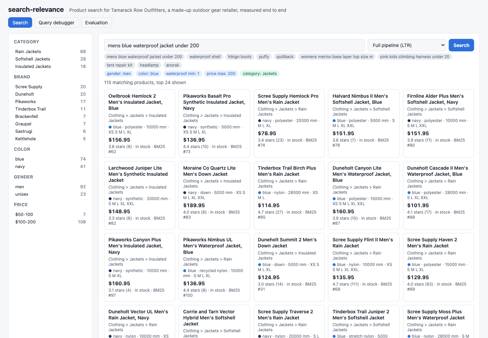
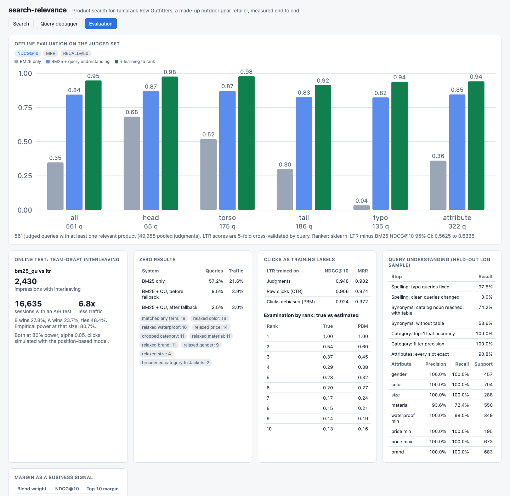
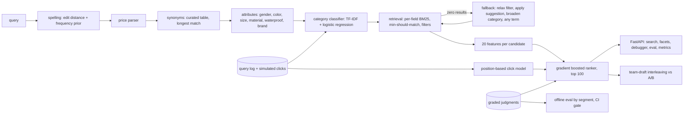
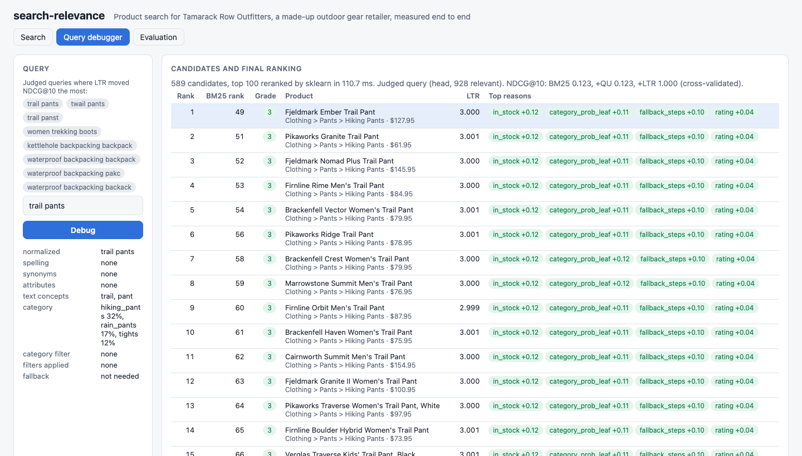

# search-relevance

Product search for Tamarack Row Outfitters, a made-up outdoor gear retailer, measured end to end. A query goes through spelling correction, synonym expansion, attribute extraction, and category classification; then BM25 retrieval over five fields with structured filters and a null-result fallback; then a learning-to-rank model that reranks the top 100. Every stage is scored offline against graded relevance judgments, click logs are debiased with a position-based click model, and two rankers are compared online with simulated team-draft interleaving. It all runs on a laptop with a seeded catalog of 20,000 products and a 50,000-search query log.



## Offline evaluation

NDCG@10 on 561 judged queries (600 judged; 39 ask for things the store does not sell and have no relevant product). Learning-to-rank scores are 5-fold cross-validated by query, so no query is scored by a model that saw its judgments.

| System | All (561) | Head (65) | Torso (175) | Tail (186) | Typo (135) | Attribute (322) |
|---|---|---|---|---|---|---|
| BM25 only | 0.348 | 0.683 | 0.519 | 0.299 | 0.035 | 0.361 |
| BM25 + query understanding | 0.845 | 0.869 | 0.872 | 0.825 | 0.824 | 0.846 |
| + learning to rank (served) | **0.948** | 0.976 | 0.979 | 0.915 | 0.938 | 0.941 |

| System | MRR | Recall@50 | Zero results (queries) | Zero results (traffic) |
|---|---|---|---|---|
| BM25 only | 0.406 | 0.347 | 57.2% | 21.6% |
| BM25 + query understanding | 0.959 | 0.828 | 2.5% (9.5% before fallback) | 3.0% (3.9% before) |
| + learning to rank | 0.982 | 0.839 | same candidates | same candidates |

Paired bootstrap 95% intervals on NDCG@10: query understanding adds +0.460 to +0.532 over BM25; learning to rank adds +0.094 to +0.112 on top. Weighted by search traffic, NDCG@10 is 0.683, 0.868, and 0.972. CI reruns this at full size and fails the build if the full pipeline's NDCG@10 is not above BM25 only.

Head, torso, and tail are clean query strings by log frequency (100+ searches, 10 to 99, under 10). Typo is any query with an injected misspelling. Attribute is any clean query with at least one of gender, color, size, material, waterproof, or price.

What each stage fixes:

- **BM25 alone** fails on anything with words the catalog does not contain ("under", "200", "mens" when the title says "Men's" only on some products) because every term must match, and it fails completely on typos (0.035 NDCG).
- **Query understanding** turns those words into filters, fixes 97.5% of typo queries with no false corrections on 1,728 clean queries, and reaches the catalog's own noun for 74.2% of leaf queries (53.6% without the synonym table).
- **Learning to rank** pushes down what text matching cannot see: out-of-stock items, poorly rated items, repair kits that contain every word of "rain jacket", and products in the wrong category.

### Clicks as labels, and the click model

| LTR trained on | NDCG@10 | MRR |
|---|---|---|
| Judgments (served) | 0.948 | 0.982 |
| Raw clicks (CTR per query and product) | 0.906 | 0.974 |
| Clicks debiased with a position-based model | 0.924 | 0.972 |

24,196 logged sessions of judged queries, 54,599 clicks. Shoppers examine rank k with probability 1/k^0.9 and click with a probability set by the true grade. Raw CTR rewards whatever production already ranked first. The PBM, fit by expectation maximization, separates position from attractiveness and wins back 43% of the NDCG lost by training on raw clicks (0.906 to 0.924, against 0.948 for judgments). Its examination estimates are biased high below rank 2 (estimated 0.60, 0.45, 0.38 vs true 0.54, 0.37, 0.29) because production only randomizes 10% of sessions.

### Online test: interleaving vs A/B

| Comparison | Interleaving impressions | A/B sessions (clicks per search) | A/B sessions (searches with a click) | Ratio |
|---|---|---|---|---|
| BM25 + QU vs + LTR | 2,430 | 16,793 | 16,635 | 6.8x |

Both at 80% power and alpha 0.05. Team-draft interleaving: LTR wins 27.8% of impressions, BM25 + QU 23.7%, ties 48.4%. Resampling 300 experiments at 2,430 impressions detected the difference 80.7% of the time, which checks the formula. Shoppers in the simulation differ in click propensity (Gamma distributed) and patience, and usually stop after a good click. That between-shopper variance is what slows the A/B test; interleaving shows both rankers to the same shopper and cancels it.

### Margin as a business signal

Margin is not a ranking feature. It can be blended in after ranking: `score / sd(score) + w * z(margin)`.

| Blend weight w | NDCG@10 | Average margin of the top 10 |
|---|---|---|
| 0 | 0.948 | 39.0% |
| 0.1 | 0.948 | 47.1% |
| 0.5 | 0.945 | 47.5% |
| 1.0 | 0.940 | 47.6% |

A small weight reorders products the model scores as equally relevant and costs nothing; past that it starts trading relevance for margin.

## Why

Product search fails quietly. A shopper types "mens blue waterproof jacket under 200", the engine looks for documents containing the word "under", finds nothing, and the shopper leaves. Or the engine returns "Rain Jacket Repair Tape" first because it contains every query word. Teams fix one query at a time and cannot tell whether the fix helped or broke something else, because they have no judged set, no per-segment metrics, and no way to read clicks without position bias. This repo shows the measurement loop: graded judgments, NDCG by segment, a gate in CI, a debugger that explains any single query, click debiasing, and an online test that needs far less traffic than an A/B test.



## Architecture



| Piece | File |
|---|---|
| Catalog: 37 leaf categories under 17 parents, 24 invented brands, latent quality | `src/searchrel/catalog.py` |
| Query log: Zipf-Mandelbrot head and tail, synonyms, attribute queries, typos, null queries | `src/searchrel/querylog.py` |
| Hidden relevance model (the judges), grades 0 to 3 | `src/searchrel/oracle.py` |
| Tokenizer and light stemmer | `src/searchrel/text.py` |
| Spelling: symmetric-delete lookup, Damerau-Levenshtein, frequency prior | `src/searchrel/spelling.py` |
| Synonym table (52 entries) | `src/searchrel/synonyms.py` |
| Attribute and price extraction | `src/searchrel/attributes.py` |
| Category classifier | `src/searchrel/classifier.py` |
| Query understanding pipeline | `src/searchrel/understanding.py` |
| Inverted index and per-field BM25 (k1 1.2, b 0.75) | `src/searchrel/index.py` |
| Retrieval, filters, fallback, facets | `src/searchrel/retrieval.py` |
| Ranking features | `src/searchrel/features.py` |
| Ranker and per-feature explanations | `src/searchrel/ltr.py` |
| Position-based click model, EM fit | `src/searchrel/clickmodel.py` |
| NDCG, MRR, recall | `src/searchrel/ir.py` |
| Team-draft interleaving, sample sizes | `src/searchrel/interleave.py` |
| Training, cross-validation, every report | `src/searchrel/evaluate.py` |
| Engine, service, UI, logs, metrics | `engine.py`, `app.py`, `static/index.html`, `logs.py`, `metrics.py` |

Details worth knowing:

- **The judges are hidden.** Each logged query comes from an intent (category, brand, attributes). The hidden model grades a product 3 when the category and every asked-for attribute match, takes points off for each miss (wrong gender or brand costs 2), and takes one more off for out of stock or a rating under 3. A sibling category or a gear care item for the right product is a 1. Search code never imports it.
- **Judgments are pooled.** Each judged query has grades for the union of the top 100 from BM25 only and from BM25 + QU: 49,958 judgments. Because the data is synthetic, the ideal DCG and the recall denominator use the hidden model over the whole catalog, so a system cannot look good by retrieving less.
- **BM25 per field**: title 3.0, brand 2.0, category path 2.0, attributes 1.0, description 0.5. Each field keeps its own length normalization, and each field's score is a ranking feature.
- **Minimum should match**: one or two query concepts must all match; three or more need 75%. A synonym makes a concept match either phrase ("waterproof shell" or "rain jacket").
- **Spelling** runs word by word before the price parser, so "uder $50" becomes a price filter. Unknown words are corrected automatically; known but rare words next to a far more common one get a "did you mean" instead, which the fallback applies only if the query returns nothing.
- **Category filter** applies only when the classifier is confident: 60% for a leaf, or 75% summed over a parent's leaves. It filters 24% of held-out queries and was right every time on that sample, because the noun phrases repeat; its job is to keep repair kits out of "rain jacket".
- **Fallback order** when nothing matches: relax extracted filters least important first (size, color, material, waterproof, price, gender, brand), apply spelling suggestions, broaden the category leaf to parent and then drop it, then match any term. Facet filters the shopper clicked are never relaxed. Every step is returned with the results and counted in `/metrics`.
- **Explanations**: the debugger shows each result's top four feature contributions. For scikit-learn trees this walks every tree and credits each split's change in node value to its feature (Saabas), so contributions add up exactly to the score; LightGBM returns tree SHAP values.
- **Ranker backend**: LightGBM lambdarank when installed (`uv sync --extra lightgbm`, needs libomp on macOS), otherwise scikit-learn gradient boosting trained pointwise on the grade. The numbers above are the scikit-learn fallback, which is what CI runs. Scores within 0.01 count as ties and keep BM25 order.



## How to run

Requires [uv](https://docs.astral.sh/uv/). Docker is optional and is built in CI (it is not installed on the machine this was written on).

```bash
make install       # uv sync --python 3.12
make run           # API and UI on http://127.0.0.1:8846 (startup builds everything, about 30 s)
make eval          # full evaluation, writes reports/evaluation.json and prints the tables (about 1 minute)
make eval-gate     # same, exits 1 if the full pipeline's NDCG@10 is not above BM25 only
make debug Q="mens blue waterproof jacket under 200"
```

Try the API:

```bash
curl -s 'localhost:8846/api/search?q=mens%20blue%20waterproof%20jacket%20under%20200&limit=5'
curl -s 'localhost:8846/api/search?q=tent&ranker=bm25&color=green&price_max=300'   # ranker: ltr, bm25_qu, bm25
curl -s 'localhost:8846/api/search?q=hikign%20boots'                                # spelling: showing_results_for
curl -s 'localhost:8846/api/debug?q=pink%20kids%20climbing%20harness%20under%2020&top=10'
curl -s localhost:8846/api/eval
curl -s localhost:8846/metrics | grep searchrel_
```

Sizes come from `SEARCHREL_PRODUCTS`, `SEARCHREL_SEARCHES`, `SEARCHREL_JUDGED`, and `SEARCHREL_SEED`. The service serves `reports/evaluation.json` when its configuration matches and otherwise computes the evaluation on the first `/api/eval` call.

## Tests

118 tests, `uv run --python 3.12 --group dev pytest -q`, about 15 seconds.

- Tokenization and stemming, BM25 idf and tf saturation, length normalization, field boosts, query weights, minimum-should-match.
- Edit distance (10 cases), typo correction (6), no correction for known words, numbers, and short tokens, suggestions for rare words, frequency priors, spelling before price parsing.
- Price parsing (11 phrasings), attribute extraction (21 phrasings including multi-attribute queries and three-word brands), synonym longest match and weights, the no-understanding baseline.
- Retrieval: the repair tape trap, attribute filters, filter semantics, fallback order and stopping, spelling then category then any-term, explicit filters never relaxed, facet counts, feature values.
- Ranker learns a planted signal on a tiny set and its contributions add up to the score; the PBM recovers a known position bias and per-grade attractiveness; raw CTR is position biased and PBM is not.
- NDCG, MRR, and recall against hand-computed values; team-draft has no duplicates and balanced teams, ties on identical rankers, credit assignment (5 cases), sample size formulas.
- API end to end on a small engine: health, UI, search with filters and facets, spelling, rankers, validation, debugger, evaluation, metrics; the full pipeline beats BM25 and the fallback lowers zero results.

## Production notes

- **Judgments** would come from trained raters with written guidelines on a few thousand queries sampled by segment, refreshed quarterly, with inter-rater agreement tracked. The hidden model here is a stand-in for them.
- **Retrieval** would run on OpenSearch or Vespa with the same field boosts, filters as indexed keyword fields, and a dense vector retriever alongside BM25 for vocabulary the synonym table misses ("anorak" returns nothing here, on purpose).
- **The randomization bucket** that makes click debiasing work (10% of sessions here) would be sized against its revenue cost, or replaced by intervention harvesting from natural ranking changes.
- **The ranker** would retrain weekly on judgments plus debiased clicks, with this NDCG gate and a per-segment no-regression check before promotion, then an interleaving test before an A/B test on revenue.
- **Interleaving** decides which ranker shoppers prefer. Revenue, margin, and returns still need an A/B test, but only for the candidates that win interleaving.
- **Query understanding** would be versioned like a model: the synonym table and attribute lexicon in a reviewed config repository, with the labeled sample rerun on every change.

## License

MIT. See [LICENSE](LICENSE).
